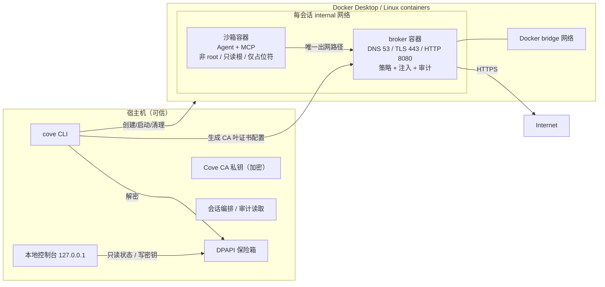
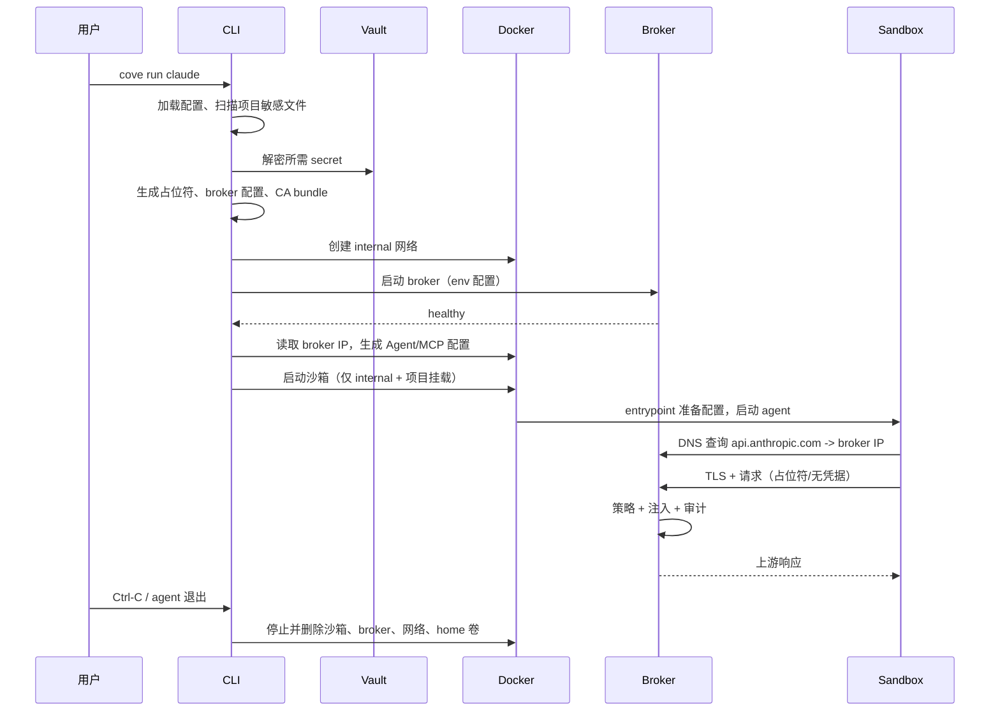
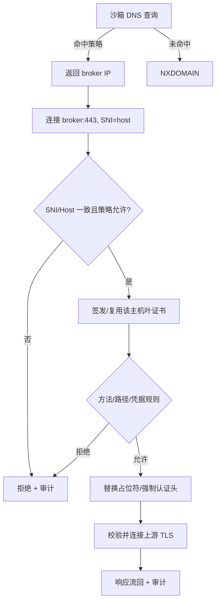

# Cove 设计文档

| 项目 | 内容 |
| --- | --- |
| 版本 | v0.1 |
| 状态 | 已评审，作为实现基线 |
| 日期 | 2026-10-26 |
| 关联文档 | [需求文档](requirements.md)、[威胁模型](threat-model.md)、[ADR](adr/) |

## 1. 设计摘要

Cove 在单台桌面电脑上把 Agent 放进一个**无直接出网能力**的 Linux 容器，把真实凭据留在宿主机的
DPAPI 保险箱，并用一个可信 broker 容器同时承担 DNS、TLS 终止、策略、凭据注入和审计。

三个关键决定：

1. **Docker 容器是安全边界**。不是 VM；明确接受容器/内核逃逸风险（见威胁模型）。
2. **DNS + 透明 TLS，而不是让 Agent 配代理**。broker 对白名单域名返回自己的 IP，在 443 端口用
   每次安装独立的 CA 签发叶证书，从而在不依赖客户端支持 `HTTPS_PROXY` 的情况下看到并改写请求。
3. **凭据不进入沙箱**。沙箱只拿到一次性占位符；broker 在请求离开宿主前替换为真实值，或对固定
   Provider 强制写入认证头。Agent 的模型流量另走 `http://broker:8080/<route>` 反向代理，避免依赖 CA。

## 2. 信任边界与运行单元



- **可信**：宿主机用户、Cove CLI/UI 进程、broker 镜像与进程。
- **不可信**：沙箱内的一切（Agent、MCP server、下载的包、项目代码）。
- 沙箱与 broker 共享一个 Docker `internal` 网络；沙箱没有任何其他网络。
- broker 同时接入该 internal 网络和 Docker bridge 网络，是唯一有出网能力的一方。
- 宿主机与沙箱之间不共享 home、Docker socket、SSH agent、X11/Wayland socket。

## 3. 组件

| 组件 | 语言/位置 | 职责 | 不做什么 |
| --- | --- | --- | --- |
| CLI `cove` | TypeScript / `src/cli` | 初始化、密钥、MCP、会话、诊断、审计 | 不把密钥写入沙箱 |
| 本地控制台 | TypeScript + 静态 HTML/CSS/JS / `src/ui` | 引导、密钥、MCP、状态、审计 | 不远程监听、不加载第三方脚本 |
| Vault | `src/vault` | DPAPI 加解密、密钥元数据、原子写 | 不缓存明文到磁盘 |
| CA Manager | `src/broker/ca` | 生成/加载 CA，按主机签发叶证书 | 不把 CA 私钥交给沙箱 |
| Broker | `src/broker` | DNS、透明 TLS、反向代理、策略、注入、审计 | 不执行 Agent 代码、不暴露管理 API |
| Docker Runtime | `src/docker` | 镜像、网络、容器、健康检查、清理 | 不挂载 Docker socket 到沙箱 |
| Agent Adapters | `src/agents` | 启动命令、环境、配置生成 | 不把真实密钥写入配置 |
| MCP Catalog | `src/mcp` | preset、传输、所需密钥、允许域名、配置生成 | 不支持原始 TCP（v0.1） |
| Session Store | `src/session` | 会话元数据、状态、清理 | 不保存密钥/占位符 |

### 3.1 目录结构（目标）

```text
src/
  cli.ts, cli/
  core/        errors, paths, config, validation, redaction, preflight
  vault/       vault, dpapi, file-protector (test)
  docker/      runtime, images, network, sandbox, broker-container
  broker/      main, dns, tls, proxy, reverse, policy, injection, audit, ca
  agents/      profiles, claude, codex, dsh, shell
  mcp/         catalog, state, render
  session/     store, lifecycle
  ui/          server, api, public/
docker/        broker.Dockerfile, sandbox.Dockerfile, entrypoint.sh
test/          unit/, integration/
docs/          requirements, design, threat-model, adr/, reviews/, user-guide
```

## 4. 数据模型

### 4.1 全局配置 `~/.cove/config.json`

```json
{
  "version": 1,
  "images": {
    "broker": "cove-broker:0.1.0",
    "sandbox": "cove-sandbox:0.1.0"
  },
  "resources": { "cpus": 2, "memory": "4g", "pids": 512 },
  "ui": { "port": 7777 },
  "sessionRetentionDays": 14
}
```

### 4.2 项目配置 `<project>/.cove/project.json`（可选）

```json
{
  "version": 1,
  "name": "my-project",
  "security": { "allowProjectSecretFiles": false },
  "egress": {
    "extraHosts": [
      { "id": "internal-api", "host": "api.internal.example", "methods": ["GET"] }
    ]
  },
  "resources": { "memory": "6g" }
}
```

未提供时使用默认值；`cove run` 不要求用户创建该文件。

### 4.3 MCP 状态 `~/.cove/mcp.json`

```json
{
  "version": 1,
  "servers": [
    { "preset": "github", "enabled": true, "secretId": "github" },
    { "preset": "filesystem", "enabled": true }
  ]
}
```

只保存 preset 和 secret 引用；不保存密钥值或占位符。

### 4.4 会话 `~/.cove/sessions/<id>/session.json`

```json
{
  "version": 1,
  "id": "01J...",
  "createdAt": "2026-10-26T02:00:00.000Z",
  "updatedAt": "2026-10-26T02:00:00.000Z",
  "state": "starting|running|stopped|failed",
  "project": "D:\\code\\my-project",
  "agent": "claude",
  "container": "cove-sb-<id>",
  "broker": "cove-br-<id>",
  "network": "cove-net-<id>",
  "homeVolume": "cove-home-<id>",
  "webPort": null,
  "secretIds": ["anthropic", "github"],
  "mcp": ["github"]
}
```

目录权限 `0700`；文件 `0600`。不出现密钥、占位符、CA 私钥。

### 4.5 审计事件 `audit.jsonl`

```json
{
  "ts": "2026-10-26T02:00:01.123Z",
  "session": "01J...",
  "kind": "http",
  "host": "api.anthropic.com",
  "method": "POST",
  "path": "/v1/messages",
  "status": 200,
  "ms": 842,
  "bytes": 12034,
  "credential": "anthropic",
  "rule": "agent-anthropic",
  "action": "allow",
  "reason": ""
}
```

禁止字段：Header、Body、查询串、真实密钥、占位符、上游响应体。`path` 截断到 512 字符并去除
控制字符。

### 4.6 Broker 配置（仅进程环境）

由 CLI 序列化为 JSON、Base64 后通过 `COVE_BROKER_CONFIG` 传给 broker 容器：

```json
{
  "sessionId": "01J...",
  "brokerIp": "172.20.0.3",
  "auditPath": "/audit/audit.jsonl",
  "ca": { "certPem": "...", "keyPem": "..." },
  "policy": [
    { "id": "agent-anthropic", "host": "api.anthropic.com", "methods": ["POST"],
      "paths": ["/v1/"], "credential": "anthropic" }
  ],
  "credentials": [
    { "id": "anthropic", "value": "<real>", "placeholder": "sk-ant-cove_<random>",
      "hosts": ["api.anthropic.com"],
      "inject": { "header": "x-api-key", "mode": "force" } }
  ],
  "reverseRoutes": [
    { "id": "anthropic", "prefix": "/anthropic", "upstream": "https://api.anthropic.com",
      "credential": "anthropic", "methods": ["GET", "POST"], "paths": ["/v1/"] }
  ],
  "limits": { "bodyBytes": 16777216, "auditBytes": 10485760 }
}
```

为什么允许用容器环境传密钥：

- 沙箱是独立的网络/文件命名空间，无法读取 broker 的 `/proc` 或环境。
- 能 `docker inspect` 的是宿主机当前用户，已经在信任边界内（该用户也能解密 DPAPI）。
- 相比把明文写入宿主机临时文件，环境变量在容器删除后不残留，且不需要处理 Windows 文件权限。
- broker 启动后立即 `delete process.env.COVE_BROKER_CONFIG`，不向子进程继承。

残余风险：宿主机上的进程/管理员可读取容器环境；这与宿主机信任假设一致，写入威胁模型。

## 5. 关键流程

### 5.1 `cove setup`

1. 检查 `docker` 可执行、`docker info` 成功、Server.OSType=linux。
2. 创建 `~/.cove`（0700）、`sessions/`、`ca/`。
3. 若 CA 不存在：生成 RSA-2048 CA（10 年），公钥写 `ca/ca.pem`，私钥用 DPAPI 加密存入 vault
   的系统条目；不写入明文文件。
4. 加载/创建 vault 元数据；验证一次加解密往返。
5. 检查镜像；缺失时提示并构建（`--build` 可跳过交互）。
6. 写全局配置；输出三项状态和下一步命令。

### 5.2 `cove secret set <id>`

1. 交互读取（终端不回显；`--stdin` 供自动化）。
2. 校验长度（1 B–64 KiB）、ID 格式；不 trim 内容（除末尾换行由读取器处理）。
3. 若该 ID 是已知 Provider，合并其默认 hosts；否则按 `--hosts` 必填。
4. DPAPI 加密；原子写 vault；不打印值，不写 shell history。

### 5.3 `cove run <agent>`



失败关闭点：

- vault 解密失败、CA 缺失、镜像缺失、网络创建失败、broker 不健康、broker IP 获取失败、
  配置文件生成失败 → 不启动沙箱，清理已创建资源。
- 清理失败 → 保留 `session.json` 并标记 `failed`，提示 `cove down <id>`。

### 5.4 出网请求处理



- DNS 只回答策略中出现的域名；不转发沙箱 DNS 到公网，避免 DNS 隧道。
- broker 不信任客户端提供的 Host/SNI/URL；三者必须一致。
- 上游连接使用 `servername` 校验证书；禁止 `rejectUnauthorized:false`。
- 解析出的 IP 若为私网/环回/链路本地则拒绝（测试模式除外）。

### 5.5 反向代理（Agent 模型流量）

| 路径前缀 | 上游 | 注入 | Agent 配置 |
| --- | --- | --- | --- |
| `/anthropic` | `https://api.anthropic.com` | `x-api-key: <real>` | `ANTHROPIC_BASE_URL=http://broker:8080/anthropic` |
| `/openai` | `https://api.openai.com` | `Authorization: Bearer <real>` | Codex provider `base_url=http://broker:8080/openai/v1` |
| `/deepseek` | `https://api.deepseek.com/anthropic` | `x-api-key: <real>` | `DEEPSEEK_BASE_URL=http://broker:8080/deepseek` |

- 只允许配置中的方法/路径；前缀剥离后拼接上游路径。
- 反向代理只监听 internal 网络（broker 的 8080），不发布到宿主机。
- 即使 Agent 忽略 base URL 直连上游，透明 TLS 路径仍会注入，形成双保险。

### 5.6 MCP

1. `cove mcp add github`：查找 preset；需要密钥则提示一次并存入 vault（带 preset 的 hosts）。
2. 将 `{preset, secretId}` 写入 `~/.cove/mcp.json`。
3. 每次运行生成三份配置：
   - Claude Code：`claude-mcp.json`，以 `--mcp-config` 传入，不写项目 `.mcp.json`。
   - Codex：`~/.codex/config.toml`，由 entrypoint 从只读配置目录复制。
   - DSH：`~/.dsh/profiles/web/cordis.patch.yml`，插入 `@deepseek-ai/dsh-mcp-client` 条目。
4. 配置中的密钥位置一律写占位符：
   - stdio：`env: { "BRAVE_API_KEY": "<placeholder>" }`
   - HTTP：`headers: { "Authorization": "Bearer <placeholder>" }`
5. 本地 stdio MCP 进程由 Agent 启动，继承沙箱 CA 环境；其 HTTPS 出网走 broker。
6. 远程 HTTP MCP 由 Agent 直接连接；同样经 DNS/TLS 到 broker。

首批 preset：

| preset | 传输 | 所需密钥 | 允许主机 | 风险 |
| --- | --- | --- | --- | --- |
| github | HTTP `https://api.githubcopilot.com/mcp/` | `github` PAT | `api.githubcopilot.com` | 写（由 token scope 限制） |
| brave | stdio `@brave/brave-search-mcp-server@2.1.4` | `brave` | `api.search.brave.com` | 读 |
| tavily | stdio `tavily-mcp@0.2.22` | `tavily` | `api.tavily.com` | 读 |
| exa | stdio `exa-mcp-server@3.4.2` | `exa` | `api.exa.ai` | 读 |
| firecrawl | stdio `firecrawl-mcp@3.34.1` | `firecrawl` | `api.firecrawl.dev` | 读 |
| context7 | HTTP `https://mcp.context7.com/mcp` | 无 | `mcp.context7.com` | 读 |
| filesystem | stdio `@modelcontextprotocol/server-filesystem@2.0.1 /workspace` | 无 | 无 | 写工作区 |

`postgres`/`mysql` 等原始 TCP MCP 在 `add` 时明确拒绝；OAuth-only 服务（Notion/Sentry/Slack）
v0.1 不列入 preset，避免诱导用户在沙箱内登录。

### 5.7 Agent 配置

| Agent | 启动 | 关键环境/配置 |
| --- | --- | --- |
| Claude Code | `claude --mcp-config /cove/config/claude-mcp.json --strict-mcp-config` | `ANTHROPIC_API_KEY=<placeholder>`、`ANTHROPIC_BASE_URL=http://broker:8080/anthropic`、关闭非必要遥测 |
| Codex | `codex` | `CODEX_HOME=/home/agent/.codex`；`config.toml` 使用 `model_providers.cove`（`base_url=http://broker:8080/openai/v1`、`env_key=OPENAI_API_KEY`、`wire_api="responses"`）；`sandbox_mode="danger-full-access"`、`approval_policy="never"`，由 Cove 提供外层沙箱 |
| DSH | `dsh web` | `DEEPSEEK_API_KEY=<placeholder>`、`DEEPSEEK_BASE_URL=http://broker:8080/deepseek`；MCP 写入 web profile patch |
| Shell | `bash` | 仅 CA/代理相关环境，无模型凭据 |

- 所有 Agent 共享 `NODE_EXTRA_CA_CERTS`、`SSL_CERT_FILE`、`REQUESTS_CA_BUNDLE`、`CURL_CA_BUNDLE`、
  `GIT_SSL_CAINFO`、`PIP_CERT` 指向信任包。
- 关闭非必要遥测/自动更新：`CLAUDE_CODE_DISABLE_NONESSENTIAL_TRAFFIC=1`、`DISABLE_TELEMETRY=1`、
  `NPM_CONFIG_UPDATE_NOTIFIER=false`；Codex/DSH 使用其支持的等价配置。
- `HOME=/home/agent`、`DSH_HOME=/home/agent/.dsh`；不读取宿主 home。
- 配置由 entrypoint 从只读 `/cove/config` 复制到会话 home；真实值从不进入该目录。

## 6. 沙箱加固参数

```text
--network cove-net-<id>            (internal)
--dns <broker-ip>
--user 1000:1000
--read-only
--tmpfs /tmp:rw,noexec,nosuid,size=1g
--tmpfs /run:rw,noexec,nosuid,size=64m
--cap-drop ALL
--security-opt no-new-privileges:true
--pids-limit 512
--memory 4g
--cpus 2
--init
--shm-size 256m
--ulimit nofile=4096:4096
--mount project -> /workspace (rw)
--mount volume  -> /home/agent
--mount session config dir -> /cove/config (ro)
--mount ca-bundle -> /etc/ssl/certs/ca-certificates.crt (ro)
```

- 不挂载 `/var/run/docker.sock`、宿主 home、SSH、云凭据目录。
- 不设置 `--privileged`、`--pid=host`、`--userns=host`、`--device`。
- 项目路径含逗号会破坏 `--mount` 解析；启动前拒绝并给出清晰错误（避免注入/误挂载）。
- 项目内 `.env`、私钥、`.npmrc` 等由 preflight 扫描；默认要求显式确认或 `--allow-project-secrets`。
- preflight 同时检查项目根目录的符号链接；指向项目外的链接默认拒绝启动。运行期新建的符号链接
  仍是已知缺口（见威胁模型 T10）。

### 6.1 信任包

`~/.cove/ca/bundle.pem` 由镜像内公共根证书 + 本次 CA 组成，挂载到
`/cove/config/ca-bundle.pem` 与 `/etc/ssl/certs/ca-certificates.crt`（只读）。这样即使工具只读
系统证书库（Rust/Go/系统 curl），也能信任 broker 的叶证书；Node/Python 再通过环境变量指向同一文件。

### 6.2 Broker 容器

```text
--network cove-net-<id> (internal) + bridge
--cap-drop ALL --cap-add NET_BIND_SERVICE
--security-opt no-new-privileges:true
--read-only --tmpfs /tmp:rw,noexec,nosuid,size=64m
--pids-limit 256 --memory 512m --cpus 1 --init
--mount audit dir -> /audit (rw)
--env COVE_BROKER_CONFIG=<base64 JSON>
```

- broker 进程以 root 启动，绑定 53/443 后立即 `setgid`/`setuid` 到 1000，并删除配置环境变量。
- 只暴露 DNS/TLS/反向代理/健康检查；没有管理 API，不发布端口到宿主机。
- `--read-only` 根文件系统；审计目录是唯一可写挂载；写入失败只记录 stderr，不影响请求。
- 健康检查访问容器内 `127.0.0.1:8081/health`。

## 7. 信任与 CA

- CA 每个安装一份；私钥 DPAPI 加密，只有 CLI 和 broker 进程能解密。
- 沙箱内挂载的只有 CA 公钥/合并信任包。
- 叶证书按 SNI 动态签发，SAN=host，有效期 7 天，内存缓存。
- 信任包 = 镜像内公共根证书 + Cove CA；同时通过环境变量覆盖 Node/Python/curl/git/Go 的默认路径：
  `NODE_EXTRA_CA_CERTS`、`SSL_CERT_FILE`、`REQUESTS_CA_BUNDLE`、`CURL_CA_BUNDLE`、
  `GIT_SSL_CAINFO`、`PIP_CERT`、`CODEX_CA_CERTIFICATE`。
- 对证书固定的客户端不兼容；`cove doctor` 无法自动检测，文档列出症状（`UNABLE_TO_VERIFY_LEAF_SIGNATURE`/
  `certificate verify failed`）。

## 8. 策略与注入

### 8.1 主机匹配

- 小写、去尾点、IDNA 转 ASCII；拒绝 IP 字面量、`localhost`、`.local`、`.internal`、空标签。
- 精确匹配，或 `*.example.com`（只匹配子域，不匹配 apex）。
- 端口固定 443；不支持自定义端口（v0.1）。

### 8.2 方法与路径

- 方法大写；`HEAD` 在规则只允许 `GET` 时放行。
- 路径使用 `new URL(path, "https://x").pathname` 规范化；按前缀匹配。
- 查询串不参与策略，不写审计；转发时保留（避免破坏 API 语义）。

### 8.3 注入

两种模式：

- `force`：删除客户端同名头，写入 `scheme + secret`；用于 Provider 的固定认证头。
- `placeholder`：在 Header 值中查找该会话占位符并替换为真实值；用于 MCP 的 `Authorization`/`X-API-Key`。

安全规则：

- 占位符只允许出现在该凭据 `hosts` 声明的主机上；出现在其他主机 → 403 + 安全审计事件。
- 占位符不会出现在审计/日志/错误中。
- 凭据只注入 Header，不支持 URL/查询串/Body 注入（v0.1）。
- 上游响应原样流回；broker 不缓存 Body。

## 9. 会话生命周期与清理

- 每个会话随机 UUID；容器/网络/卷名带会话后缀。
- 启动顺序：network → broker → 等待 healthy → 读取 broker IP → 生成配置 → sandbox。
- 清理顺序（幂等）：sandbox → broker → network → volume → 临时配置目录。
- 审计与会话元数据保留（默认 14 天），由 `cove clean`（P1）清理。
- CLI 异常退出时资源可能残留；`cove status`/`doctor` 通过 label `cove.session=<id>` 发现，
  `cove down --all` 清理。

## 10. 易用性设计

### 10.1 CLI 首次运行

```text
$ cove setup
✓ Docker Desktop (Linux containers)
✓ 保险箱 (Windows DPAPI)
✓ 本地 CA
✓ 镜像 cove-broker:0.1.0 / cove-sandbox:0.1.0
下一步：cove secret set anthropic
```

### 10.2 错误信息结构

```text
error: 未找到 Anthropic API Key
  why: 沙箱只使用占位符，broker 需要宿主机保险箱中的真实密钥
  fix: 运行 `cove secret set anthropic`，然后重试
```

每条 `CoveError` 包含 `code`、`message`、`hint`；CLI 只打印脱敏后的字段。

### 10.3 本地控制台

- 深色、低噪声的桌面控制台；无第三方字体/脚本；CSP 限制。
- 页面：概览、密钥、MCP、审计、设置。
- 密钥输入使用 `type=password`，保存后只显示"已连接 / 更新时间"。
- 所有写 API 需要 CSRF Token + 同源 Origin 校验；仅监听 `127.0.0.1`。
- 启动时自动打开浏览器；终端保持运行，Ctrl-C 关闭。

### 10.4 运行 DSH

DSH 默认提供浏览器 UI（`dsh web`）。Cove 的处理：

- 沙箱以 `dsh web --host <容器IP> --port <containerPort> --no-open --public-url http://127.0.0.1:<hostPort> --trusted-host 127.0.0.1:<hostPort>` 启动。
- Docker 只发布 `127.0.0.1:<hostPort>:<containerPort>`；宿主机浏览器访问。
- 宿主从容器日志读取带 token 的 URL，等待 HTTP 就绪后打开浏览器。
- 这是宿主机 → 沙箱的入站端口，不改变沙箱出网边界；只绑定 loopback。
- DSH 的模型流量与 MCP 流量仍从沙箱经 broker 出去；发布的端口不能作为通用出网代理。
- 限制：v0.1 不提供 `dsh --profile headless` 的交互包装；DSH 的终端形态需等其 TUI profile。

## 11. 测试策略

### 11.1 单元

- 策略：主机/方法/路径匹配、IP/私网拒绝、通配符、IDNA。
- 注入：force/placeholder、错误主机 403、Header 大小写、占位符不出现在审计。
- CA：证书 SAN、有效期、链验证。
- Vault：DPAPI 往返（Windows）、错误密码/损坏密文失败关闭、元数据不泄露。
- 配置生成：Claude/Codex/DSH 快照，断言不含真实密钥。
- Preflight：敏感文件检测、路径逗号拒绝。
- 脱敏：日志/错误/审计。

### 11.2 Docker 集成

使用真实 Docker，但上游是本地假 HTTPS 服务：

1. 构建 broker 镜像与测试上游镜像（Node + 自签测试证书）。
2. 创建 internal 网络与测试网络；启动上游、broker、沙箱。
3. 沙箱通过 broker DNS 访问 `upstream.test`，验证：
   - 收到真实注入头；
   - 未授权主机 NXDOMAIN/连接失败；
   - 直连公网失败；
   - 审计行不含密钥；
   - 沙箱 env/配置无真实密钥。
4. 清理所有资源。

### 11.3 验收

- `pnpm typecheck`、`pnpm test`、`pnpm build`。
- 构建镜像后跑 `claude --version`、`codex --version`、`dsh --version`。
- 手工走查 `cove setup`、`cove run shell`、`cove ui`。
- 真实 API Key 的端到端调用不在 CI 中执行；由用户本地验证。

## 12. 需求映射

| 需求 | 设计落点 | 验证 |
| --- | --- | --- |
| FR-01 | §5.1, `doctor` | 手工 + doctor 单测 |
| FR-02 | §6 | Docker 集成 |
| FR-03 | §5.4, §8 | Docker 集成 |
| FR-04 | §4.1, §5.2, vault | 单测 + Windows DPAPI |
| FR-05 | §5.4, §8.3 | 单测 + 集成 |
| FR-06 | §5.5, §10.4, agents | 配置快照 + 镜像版本 |
| FR-07 | §5.6 | 配置快照 + 假 MCP |
| FR-08 | §8 | 单测 |
| FR-09 | §4.5 | 单测 + 集成 |
| FR-10 | §10.3 | UI API 测试 + 手工 |
| FR-11 | §9 | 集成/清理测试 |
| FR-12 | 文档 | 评审 |

## 13. 明确不做（v0.1）

- 原始 TCP/UDP MCP、数据库直连。
- 浏览器内的终端/Agent 会话（DSH 除外，通过其 Web UI）。
- 订阅 OAuth 登录。
- 宿主机文件系统按路径白名单过滤（项目目录整体可见）。
- 写操作人工审批队列。
- 多用户/远程控制台。
- 证书固定客户端。

## 14. 待实现风险

- Windows Docker Desktop 对 bind mount 权限、文件名大小写、路径逗号的行为需在集成测试中验证。
- DSH Web 的 `--trusted-host`/`--public-url` 组合需实测；失败则退回 headless 模式并记录限制。
- Codex/DSH 的版本升级可能改变配置字段；镜像固定版本，升级需更新 catalog 与快照测试。
- 上游 CDN 域名变化会导致包安装失败；策略允许用户补充主机，doctor 输出拒绝记录。
